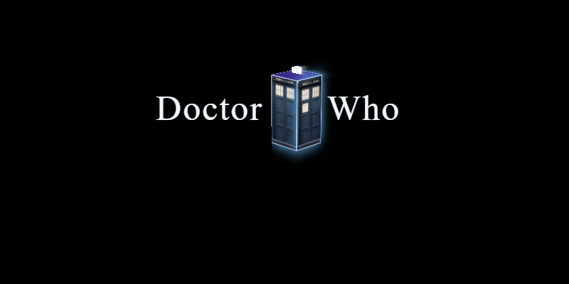

# TARDIS — Animação 3D

Uma animação inspirada na TARDIS de Doctor Who, construída somente com HTML e CSS. O projeto combina transformações tridimensionais, rotação contínua, iluminação e efeitos de interação.

## Demonstração

[](https://gabrielmatheus1.github.io/TARDIS/)



## Funcionalidades

- Modelo tridimensional com seis faces
- Mini cubo superior simulando a luz da TARDIS
- Rotação contínua com movimento de translação
- Perspectiva e profundidade criadas com CSS 3D
- Efeito de brilho ao redor das faces
- Pulsação dos textos Doctor e Who
- Desaparecimento gradual ao posicionar o cursor sobre a animação
- Execução sem JavaScript ou dependências externas

## Tecnologias

- HTML5
- CSS3
- Transformações 3D
- Animações com `@keyframes`
- Variáveis CSS

## Como funciona

A TARDIS é formada por elementos que representam as seis faces de um cubo. Cada face recebe rotações nos eixos X ou Y e deslocamento no eixo Z para criar profundidade.

As variáveis `--w`, `--h` e `--d` controlam largura, altura e profundidade. A propriedade `perspective` define a distância da câmera, enquanto a animação `giro` completa uma rotação de 360 graus em loop.

A luz superior usa a mesma técnica em uma escala menor. Sombras e transições completam os efeitos de iluminação e desaparecimento.

## Estrutura do projeto

```text
TARDIS/
├── imgs/
│   ├── frente.png
│   ├── icon.png
│   ├── lados.png
│   └── preview.png
├── index.html
├── style.css
└── README.md
```

## Aprendizados

Este projeto foi desenvolvido para praticar:

- Posicionamento de elementos em três dimensões
- Uso de `perspective` e `transform-style`
- Rotações e deslocamentos nos eixos X, Y e Z
- Criação de animações contínuas com CSS
- Construção de efeitos de luz com sombras
- Organização de medidas com variáveis CSS

## Autor

Desenvolvido por [Gabriel Izidoro](https://github.com/GabrielMatheus1).

